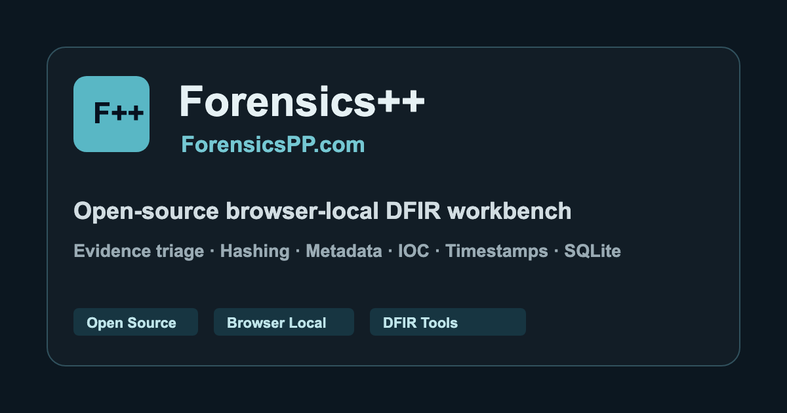

<div align="center">
  
  <h1>Forensics++</h1>
  <p>A browser-based workbench for digital forensics, incident-response triage and CTF analysis.</p>
  <p>
    <a href="https://github.com/DyNooob/ForensicsPP/releases/tag/v1.0.2"></a>
    <a href="LICENSE"></a>
    <a href=".github/workflows/ci.yml"></a>
  </p>
  <p><a href="README.zh-CN.md">简体中文</a> · <a href="https://www.forensicspp.com/">Use online</a> · <a href="https://github.com/DyNooob/ForensicsPP/releases/latest">Download</a> · <a href="docs/README.md">Documentation</a></p>
</div>

Forensics++ brings 36 workspaces into one static application: inspect files and images, examine databases and logs, extract network and email artifacts, and transform text without an analysis backend. Parsers run in the browser; expensive operations use Web Workers where implemented. The interface supports English and Simplified Chinese.

Version **1.0.2** makes the offline package directly usable by opening `index.html`: no Python, local server or first-use downloads. It retains PNG dimension recovery, localized findings and the dedicated Chinese conversion workspace. Read the [release notes](docs/releases/v1.0.2.md) for changes, verification and compatibility limits.

## Start here

| Your task | Entry point |
| --- | --- |
| Examine data immediately | [Online workbench](https://www.forensicspp.com/) |
| Work in an isolated environment | [Offline release](https://github.com/DyNooob/ForensicsPP/releases/tag/v1.0.2) and [offline guide](docs/OFFLINE.md) |
| Choose a tool | [Tool reference](docs/TOOLS.md) |
| Develop or add a parser | [Development guide](docs/DEVELOPMENT.md) and [architecture](docs/ARCHITECTURE.md) |
| Understand checks and limitations | [Validation](docs/VALIDATION.md) and [1.0 audit](docs/releases/v1.0.2-audit.md) |
| Report a defect or vulnerability | [Issues](https://github.com/DyNooob/ForensicsPP/issues) · [security policy](SECURITY.md) |

## What you can examine

| Area | Workflows |
| --- | --- |
| Images | EXIF/XMP/IPTC/ICC metadata, HEIC/HEIF preview fallback, PNG structure/CRC, QR, channels, bit planes, appended data and bounded repair attempts |
| Files and containers | Type identification, Hex and executable structure, strings, entropy, YARA, carving, archives and recursive extraction within limits |
| Firmware and disks | Chunked firmware inspection, architecture hints, embedded objects, partition/filesystem metadata and supported directory exploration |
| Databases and system artifacts | SQLite/WAL/deleted-record candidates; registry hives, Plist, EVTX, browser artifacts, Windows MFT/USN and memory triage |
| Email and network | EML/MSG, MIME attachments, PCAP/PCAPNG, TCP reassembly, HTTP/DNS and visible TLS handshake metadata |
| Android | Manifest/permissions, APK signature analysis, optional `.idsig` verification and explicitly requested re-signing |
| Text and utilities | Hashes, codecs, cryptography, JWT, password utilities, SQL, JSON, regex, timestamps, timelines, UUIDs and number bases |
| Chinese text | Offline OpenCC conversion, Taiwan/Hong Kong variants, regional phrases, file import/export and keyboard shortcuts |
| Case review | Evidence inbox, analyzer handoff, structured findings, timeline and versioned `.fppcase` export/import |

Coverage varies by tool. A parsed field or heuristic finding is a lead to review; see [tool-specific boundaries](docs/TOOLS.md) before interpreting results.

## Run the offline release

1. Download `ForensicsPP-v1.0.2-offline-static.zip` and `SHA256SUMS-v1.0.2.txt` from the [release assets](https://github.com/DyNooob/ForensicsPP/releases/tag/v1.0.2).
2. Verify the ZIP checksum and extract the complete folder.
3. Open the extracted `index.html` in current Chrome or Edge. The address starts with `file://`.

No Python, Node.js, terminal, local server or Internet connection is needed. Keep the complete directory, including the bundled CyberChef resources.

**The offline ZIP includes its JavaScript, CSS, WASM, workers, CyberChef, OpenCC dictionaries and three lookup databases. First use does not require Internet access or a warm browser cache.** External runtime resource requests are restricted by the packaged HTML policy. [Offline operation and rebuilding →](docs/OFFLINE.md)

## Develop from source

Prerequisites: Node.js **22.13+**, npm **10+** and a current browser. Chrome/Chromium is needed for browser smoke tests.

```sh
git clone https://github.com/DyNooob/ForensicsPP.git
cd ForensicsPP
npm ci
npm run dev
```

Vite prints the development URL. For the standard website build:

```sh
npm run verify
npm run preview
```

`verify` checks translations, headers, TypeScript, the production artifact and tests. Source development and dependency installation are separate from using the prebuilt offline ZIP. [Development commands and conventions →](docs/DEVELOPMENT.md)

## Architecture at a glance

```text
React workspaces → task lifecycle / workers → analyzers and parsers
                                      ↓
EvidenceReader / shared carving → AnalysisEnvelope → result history
                                      ↓
                        case reporter / timeline / .fppcase
```

Tool metadata, runtime loading and route canonicalization are centralized. Parsers remain independent of React where implemented; larger evidence uses bounded/random-access readers. Structured results preserve source, run, artifact and limitation information. [Architecture and module ownership →](docs/ARCHITECTURE.md)

## Privacy and distribution

Core examination does not upload evidence to a Forensics++ analysis service. Settings, supported workspace state and downloaded data can persist in browser storage; exported reports may contain sensitive content. Browser extensions and the host environment remain outside the application's control.

The website can use explicitly configured CDNs and on-demand lookup data. Its network behavior differs from the complete offline release. CyberChef operations that require external services are unavailable under the offline policy. [Security model](SECURITY.md) · [troubleshooting](docs/TROUBLESHOOTING.md)

## Contribute

Use synthetic or appropriately licensed public fixtures, keep changes focused and include verification. Start with [CONTRIBUTING.md](CONTRIBUTING.md). The project uses GitHub Issues and pull requests; [maintenance and decision rules](docs/GOVERNANCE.md) describe the process without promising response times or support tiers.

## License and acknowledgements

Forensics++ source is [MIT licensed](LICENSE), copyright © 2026 DyNooob. Third-party software and data retain their own licenses. The distribution includes dependency notices, data provenance and HEIC codec corresponding sources. Review [licensing and data attribution](docs/LICENSING.md), including the documented upstream phone-dataset licensing limitation.

Built with React, Ant Design and browser-native APIs, and with parsers/libraries including exifr, OpenCC JS, heic-to/libheif, sql.js, YARA-X and CyberChef. The application's **Settings → Open Source** inventory and the packaged `licenses/` directory provide component details.
