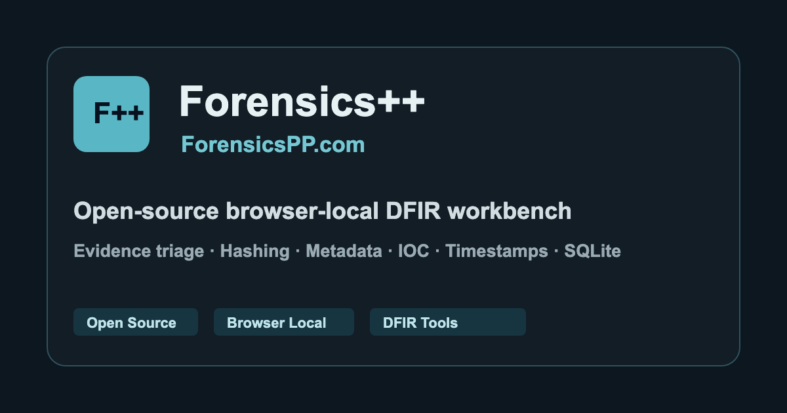

<div align="center">
  
  <h1>Forensics++</h1>
  <p>在浏览器中完成电子数据检查、事件响应初筛与 CTF 分析。</p>
  <p><a href="README.md">English</a> · <a href="https://www.forensicspp.com/">在线使用</a> · <a href="https://github.com/DyNooob/ForensicsPP/releases/latest">下载发布包</a> · <a href="docs/README.md">文档中心</a></p>
</div>

Forensics++ 将 **36 个工作台** 集中在一个静态 Web 应用中，覆盖图片、文件、数据库、日志、邮件、网络、系统痕迹和文本转换。核心分析在当前浏览器中执行，无需 Forensics++ 分析后端；已实现的重型任务由 Web Worker 承载。界面支持简体中文和英文。

**1.0.1 修订正式版**提供完整离线包，补齐 PNG 宽高恢复、中文异常分级与图片结果导航；简繁转换已成为左侧独立工具。[查看完整发布说明](docs/releases/v1.0.1.md)。

## 选择入口

| 你要做什么 | 从这里开始 |
| --- | --- |
| 立即检查文件或文本 | [在线工作台](https://www.forensicspp.com/) |
| 在竞赛、隔离网或离线环境使用 | [下载 1.0 离线包](https://github.com/DyNooob/ForensicsPP/releases/tag/v1.0.1) · [离线指南](docs/OFFLINE.md) |
| 了解工具输入与结果边界 | [工具手册](docs/TOOLS.md) |
| 从源码开发或添加分析器 | [开发指南](docs/DEVELOPMENT.md) · [架构说明](docs/ARCHITECTURE.md) |
| 了解测试覆盖 | [验证体系](docs/VALIDATION.md) · [1.0 体检记录](docs/releases/v1.0.1-audit.md) |
| 提交问题或报告漏洞 | [GitHub Issues](https://github.com/DyNooob/ForensicsPP/issues) · [安全政策](SECURITY.md) |

## 主要能力

| 方向 | 支持的工作流 |
| --- | --- |
| 图片 | 拍摄时间、设备、GPS、镜头等 EXIF 信息优先直显；元数据搜索/导出；HEIC/HEIF 本地预览；PNG chunk/CRC、二维码、颜色通道、位平面、尾部数据和有限修复 |
| 文件与容器 | 类型识别、Hex、可执行文件结构、字符串、熵、YARA、嵌入对象 carving、压缩包浏览与受限递归提取 |
| 固件与磁盘 | 分块固件检查、架构线索、对象边界、分区与文件系统元数据、已支持目录的只读浏览 |
| 数据库与系统 | SQLite/WAL/删除记录候选；注册表、Plist、EVTX、浏览器痕迹、Windows MFT/USN 和内存初筛 |
| 邮件与网络 | EML/MSG、MIME 附件、PCAP/PCAPNG、TCP 重组、HTTP/DNS 和可见 TLS 握手元数据 |
| Android | 清单与权限、APK 签名检查、可选 `.idsig` 验证、明确触发的重新签名 |
| 文本工具 | 哈希、编解码、密码算法、JWT、口令、SQL、JSON、正则、时间戳、时间线、UUID 和进制转换 |
| 中文特色 | OpenCC 离线简繁转换、台湾/香港字形、台湾地区词组、文本导入导出、键盘快捷转换 |
| 检查记录 | 证据收件箱、分析器转交、结构化发现、时间线、`.fppcase` 案件包导出与导入 |

不同分析器的格式覆盖和资源上限不同。启发式命中、声明字段、签名解析结果都应结合原始材料复核，不能直接等同于真实性、身份或归属结论。具体范围见[工具手册](docs/TOOLS.md)。

## 使用完整离线包

1. 从 [GitHub Release](https://github.com/DyNooob/ForensicsPP/releases/tag/v1.0.1) 下载 `ForensicsPP-v1.0.1-offline-static.zip` 和 `SHA256SUMS-v1.0.1.txt`。
2. 校验 SHA-256，完整解压整个文件夹。
3. 本机预装 Python 3 后，在解压目录执行：

   ```sh
   python3 start_server.py
   ```

4. 打开 `http://127.0.0.1:8765/`。Windows 可运行 `Start-ForensicsPP.bat`，macOS 可运行 `Start-ForensicsPP.command`。

启动器仅使用 Python 标准库，只监听本机回环地址，不安装 pip/npm 依赖。Python 运行时不随包分发；也可使用已有的本地静态 HTTP 服务器。完整 Worker/WASM 分析需要 HTTP，不能只双击 `index.html`。

**离线 ZIP 已包含所有运行所需 JS、CSS、WASM、Worker、CyberChef、OpenCC 词库和三类归属地数据库，首次使用无需联网或预热缓存。** 离线页面限制外部运行资源请求。详细校验、启动和重建步骤见[离线指南](docs/OFFLINE.md)。

## 从源码运行

准备 Node.js **22.13+**、npm **10+** 和当前仍维护的浏览器；真实浏览器测试需要 Chrome/Chromium。

```sh
git clone https://github.com/DyNooob/ForensicsPP.git
cd ForensicsPP
npm ci
npm run dev
```

开发服务会输出访问地址。网站构建与验证：

```sh
npm run verify
npm run preview
```

`verify` 执行翻译检查、版权头检查、类型检查、生产构建、产物检查和测试。使用预构建离线 ZIP 不需要 Node.js，也不需要安装项目依赖。[开发约定与命令](docs/DEVELOPMENT.md)。

## 架构

```text
React 工作台 → 任务生命周期 / Worker → 分析器与解析器
                                      ↓
EvidenceReader / 共享 carving → AnalysisEnvelope → 结果历史
                                      ↓
                        案件报告 / 时间线 / .fppcase
```

工具目录、运行时加载和历史路由兼容集中管理。分析逻辑尽量独立于 React；大型材料通过受限随机读取或分块扫描处理。结构化结果保留来源、运行、提取对象与限制信息。模块职责、接口与扩展步骤见[架构说明](docs/ARCHITECTURE.md)。

## 隐私与网络

核心检查不会把检材上传给 Forensics++ 分析服务。浏览器可能保存设置、支持恢复的工作区状态和数据包；导出的报告也可能包含敏感内容。浏览器扩展、主机安全和文件保全仍需使用者自行控制。

网站版本可以启用 CDN，并按需获取静态查询数据；完整离线包使用独立分发策略，不回退到外部服务。需要外网的 CyberChef 操作在离线策略下不可用。[安全政策](SECURITY.md) · [排错指南](docs/TROUBLESHOOTING.md)。

## 参与贡献

请使用合成样本或具有适当授权的公开夹具，保持改动聚焦，并提交可复现验证。阅读[贡献指南](CONTRIBUTING.md)与[项目维护规则](docs/GOVERNANCE.md)。问题通过 GitHub Issues 跟踪，代码通过 Pull Request 审查；项目不承诺固定响应时间或商业支持等级。

## 许可证与致谢

Forensics++ 源码采用 [MIT License](LICENSE)，版权 © 2026 DyNooob。第三方软件和数据保留各自许可；离线包附依赖许可证、数据来源与 HEIC 解码库对应源码。详见[许可与数据归属](docs/LICENSING.md)，其中明确记录手机号数据源原始 LICENSE 为空的限制。

感谢 React、Ant Design、exifr、OpenCC JS、heic-to/libheif、sql.js、YARA-X、CyberChef 等上游项目。组件用途可在应用“设置 → 开源依赖”查看；发布包的 `licenses/` 提供具体许可文本。
