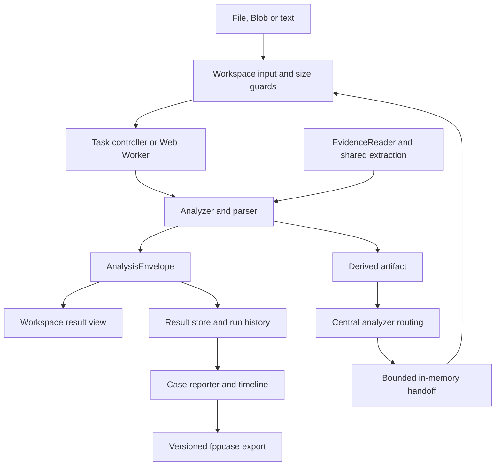

# Architecture / 架构

[Documentation](README.md) · [Analysis contracts](architecture/ANALYSIS_CONTRACTS.md) · [Runtime lifecycle](architecture/RUNTIME.md)

## Design goals

Forensics++ is a static browser application. The architecture separates examination logic, task execution, workspace presentation and result reporting so that parsers can be tested without the UI and tools can share evidence without sharing accidental state.

The implementation is incremental. Several legacy tools still use bounded full-buffer analysis or reporting fallbacks. This document describes existing boundaries and the rules for extending them; it does not claim that every tool has already adopted every abstraction.

## Module ownership

| Layer | Source | Responsibility |
| --- | --- | --- |
| Bootstrap and shell | `src/main.tsx`, `src/App.tsx`, `src/app/` | Appearance, consent, navigation, storage bootstrap, shell layout and reporting entry points |
| Tool catalog | `src/config/app.ts` | IDs, categories, names, capabilities, accepted inputs and resource policies |
| Runtime registry | `src/components/toolRuntimeRegistry.tsx`, `ToolHost.tsx` | Lazy tool loading, service injection and hosting |
| Workspaces | `src/tools/` | User input, explicit actions, progress, results and exports |
| Execution core | `src/core/runtime/`, `src/utils/workerTask.ts` | Run identity, cancellation, timeouts, stale-result guards and disposal |
| Evidence and handoff | `src/core/evidence/`, `toolHandoff.ts`, `analyzerRouting.ts` | Bounded source access, acquisition records and target routing |
| Analysis features | `src/features/<domain>/` | Parsers, analyzers, workers and envelope builders |
| Shared results | `src/features/analysis/` | Analysis contract, current results, run history and safe snapshots |
| Case/reporting | `src/features/reporter/` | Findings, evidence references, timeline and `.fppcase` |
| Distribution | `vite.config.ts`, `scripts/`, `packaging/`, `public/` | Website/offline builds, resource identity, notices and release artifacts |

## Examination flow

Transforms without an evidence-analysis contract can return their text result directly. Their existence does not imply a forensic envelope or case-reporting capability.

## Evidence access

[`EvidenceReader`](../src/core/evidence/reader.ts) exposes `size`, `read(offset, length, options)`, `slice(offset, length)` and `stream(offset, length)`. Blob-backed reads constrain allocation to the selected range. Range validation rejects invalid offsets and lengths. Read cancellation is explicit.

Firmware and disk workflows use random-access/chunked reading. Existing full-buffer workers remain appropriate only within their declared bounds. Adding a reader abstraction does not make an analyzer streaming if the caller immediately reads the entire source.

The evidence inbox retains `File` references in memory for the session. Logical evidence identity is distinct from a computed content digest. A missing SHA-256 remains missing; metadata-derived IDs must never be presented as content hashes.

## Parsing, carving and extraction

[`carver.ts`](../src/features/file/carver.ts) separates identification from extent resolution. An artifact can have an exact, structural, heuristic or unknown boundary. Magic alone does not establish that a complete object was recovered.

[`containerExtractors.ts`](../src/features/file/containerExtractors.ts) expands supported ZIP/APK/JAR, gzip, zlib, TAR and CPIO containers under entry/count/expanded-byte/ratio limits. [`recursiveCarver.ts`](../src/features/file/recursiveCarver.ts) adds depth and object budgets. Self-hits are not recursively re-entered without bound.

A parser should return structured values and limitations rather than formatted UI strings. Where legacy parsers still return display rows, keep new forensic fields machine-readable in the analyzer result rather than adding further presentation-dependent contracts.

## Tool organization

Tool definitions are the catalog; runtime renderers are the implementation map. Navigation and [`routeAdapter.ts`](../src/core/routeAdapter.ts) resolve website routes, hash routes and historical aliases to canonical IDs. SEO route metadata is centralized in `src/seo/toolRoutes.mjs`.

Image consolidates metadata, PNG, QR, channels and hidden-data analysis around one source. Binary consolidates identification, executable structure, strings, entropy, YARA and object discovery. Heavy optional analysis remains explicit and lazy. Firmware, disk, SQLite and PCAP stay separate because their readers, state and interpretation differ. See [workbench organization](WORKBENCH_CONSOLIDATION.md).

## Execution and cleanup

A user action creates a run. Input changes, Clear, navigation or cancellation must prevent the previous run from publishing stale output. Worker helpers terminate work on completion, failure, timeout and abort. Resource profiles decide whether an inactive workspace is retained, suspended or disposed.

Generated blob URLs, timers, canvases, abort listeners and large arrays have owners. The creator or explicitly designated owner releases them; switching language must not revoke an active image preview. These lifecycle requirements are detailed in [RUNTIME.md](architecture/RUNTIME.md).

## Results and reporting

[`AnalysisEnvelope<T>`](../src/features/analysis/result.ts) preserves analyzer identity, sources, run parameters/timestamps, summary, findings, indicators, artifacts, timeline, limitations and domain data. The result store assigns run history and serializes safe case snapshots. The reporter prefers structured results and retains a legacy fallback where necessary.

The `.fppcase` writer emits schema 1.1 and accepts 1.0/1.1 on import. Internal member digests and expansion limits are checked. Raw source evidence is reference-only by default. [Contract details and compatibility →](architecture/ANALYSIS_CONTRACTS.md)

## Domain boundaries

| Domain | Key distinction |
| --- | --- |
| Images | Original bytes feed EXIF/container analysis; HEIC conversion is a preview derivative. Capture text without an explicit timezone is not silently relabeled UTC. |
| SQLite | Live rows, historical WAL versions and heuristic recovery candidates have distinct provenance. Missing overflow pages and unknown rowids remain explicit. |
| Android | Parsing, cryptographic verification and re-signing are separate operations. Re-signing creates a new identity; it does not recover the original developer's private key. |
| PCAP | Reassembly can be incomplete. TLS analysis concerns visible handshake metadata, not application-traffic decryption. |
| Disk and memory | Supported metadata/directory/minidump/PE discovery is scoped browser triage, not a claim of full TSK or Volatility equivalence. |
| Lookup | Fixed datasets and validation rules are not live location or authoritative identity/ownership services. |

## Website and offline builds

Website mode emits lazy chunks and can opt into a validated CDN deployment. Offline mode keeps runtime dependencies local, includes fixed datasets and codec sources, adds local-resource policies and rejects missing local inputs. The service-worker namespace is derived from version and built-asset identity rather than a hand-maintained release string.

Build outputs, local input caches, evidence and screenshots do not belong in the source commit. Release ZIPs are published as GitHub assets. [Offline contract](OFFLINE.md) · [hosting](CDN.md) · [release process](RELEASE.md)

## Extension rules

1. Reuse the tool catalog and runtime registry instead of adding another conditional router.
2. Keep analyzers testable without React and choose readers according to actual input size/access patterns.
3. Declare execution, memory, expansion and output bounds.
4. Preserve source offsets, derived-artifact lineage, run identity and uncertainty.
5. Use central routing and handoff rather than importing another workspace's parser into the caller.
6. Add valid, malformed and boundary cases; use independent expected values where possible.
7. Update tool help, documentation, translations, dependency notices and relevant release notes.
